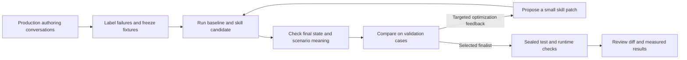

# Evaluating and improving Cekura scenario skills

The approved follow-up is implemented in
[`experiments/scenario_skills/v2`](../../experiments/scenario_skills/v2/domain_spec.md):
72 tasks in 48 packs, split 36 training / 12 validation / 24 sealed. Every
ordinary scored rollout runs the matching target runtime against an isolated
copy of the pinned real backend and its real generator. Only frozen, recorded
injections stand in for exceptional conditions. The design also has:

* preserved native history;
* a human-qualified, blinded Claude semantic judge;
* up to four proposal attempts, with at most two fully evaluated;
* independent selection with worst-case treatment of uncertainty.

One canonical $150 wallet admits every target request, nested generator call,
probe and sandbox before forwarding; historical spend is carried once. Human
fixture/gold approval and launch approval precede inference. After that, one
command runs through to a terminal report, and final patch acceptance follows it.

The following smoke measurements remain historical. Their three baseline
`source_inputs` failures were literal-fragment mismatches, not proof of missing
source meaning. An audit found faithful paraphrases could fail while omitted
policies or wrong saved outcomes could pass. V2 replaces that weak oracle and
adds broader challenges and positive contrasts. No v2 model result or accepted
skill improvement is claimed by implementation or offline testing.

Research date: 2026-10-22; execution completed 2026-10-23. The bounded authoring-conversation diagnosis
is complete, and an executable synthetic smoke benchmark is implemented and
locally verified, including offline execution of the captured production runtime
image. Machine preflight now passes with original schemas exported through
Codex. The user authorized engineering fixture checks before paid execution,
with human semantic review deferred until patch acceptance. The baseline and
two-proposal loop completed **60 conclusive target rollouts** in the matching
image. Candidate 1 was selected: training **11/12 → 12/12**, independent
validation **5/6 → 6/6**, with no new validation failure. Candidate 2 also passed
6/6 validation but regressed on complete scenario text in training; the agreed
smaller-skill tie-break selected candidate 1. The fixed-target baseline passes **21/24**
observable contracts: training **11/12**, validation **5/6**, and sealed baseline
**5/6**. All three failures concern literal source fragments absent from generation
arguments. These are results under the original weak check; semantic improvement remains unproven.
The selected suggestion forwards complete source text and verifies generated
expected outcomes. Accounted spend is **$28.83728485**, including $7.30 retained
infrastructure reservations. No candidate sealed execution or accepted patch
was produced, and no released skill has been promoted. See the
[domain specification](../../experiments/scenario_skills/domain_spec.md) and
[implementation/comparison report](scenario-skill-smoke-report.md).
The older [20-case catalog](scenario-skill-cases.json) remains research intake,
separate from the new frozen 24-task benchmark. Private evidence stays outside
this repository. Diagnosed `product_chat` records represent Cekura assistant
authoring conversations, rather than customer voice-agent production calls.

## Recommendation

Build a repeatable evaluation of the **assistant that authors scenarios**,
starting with `cekura-eval-design`. Keep a separate track for
`cekura-generate-scenarios`, which turns voice-call evidence into regression
scenarios. First establish the production failure taxonomy and an executable
baseline; then automate candidate skill edits and comparisons. Use the existing
product-chat failure collector as the intake, a replay adapter as the evaluator,
and a bounded optimizer around that evaluator. The
[expanded alternatives research](skill-optimizer-alternatives.md) retains the
framework comparisons. The agreed first implementation uses Stanford's original
Meta-Harness with Codex as proposer and an independent Cekura evaluator.
The user's later preference selects an isolated EC2 Claude Code proposer using
the same training-only history loop. Its actual schema-output connection check
passed; the deployed Pi/Fireworks Messages transport passed with fixed responses.
Codex supplied a one-time authenticated export of 190 original Cekura tool
definitions. All 24 scripted contracts and the matching image pass with that
catalog. Claude needs only skill material and training failures; local MCP
fixtures serve the fixed target without production access.
Those preflight checks establish execution compatibility. The completed smoke
adds a measured gain on its literal source-input check on independent validation;
semantic usefulness remains unsigned. No framework has demonstrated superiority
on Cekura's workload.

The valuable output is a skill patch with evidence that it creates more valid,
useful tests on unseen tasks. A critique of a prompt, a higher self-assessed
score, or a PR with no replay comparison does not establish that improvement.

## What the current evidence establishes

The [production diagnosis](scenario-skill-production-diagnosis.md) reviews 12
selected authoring-related conversations: six likely failures, three activation
checks, and three controls. It reuses seven cached complete transcripts and
retrieves only five Excel-truncated records through Cekura MCP, sequentially,
with private checkpoints. No additional list pages, metric-definition datasets,
reevaluations, or simulations were fetched or run during that pilot. The next
benchmark targets behavioral batch write-path selection while protecting valid
verbatim, conditional-action, update, and approval workflows.

The production investigation found an existing product-chat improvement job.
Its source explicitly describes itself as the failure-triage-to-PR half and
excludes simulation and accuracy evaluation. Its optimizer permits changes to
the assistant system prompt, skill activation descriptions, and tool/schema
descriptions. It explicitly classifies skill **body** corrections as outside
its editable scope. Extending this job therefore requires both a new editable
surface and a way to verify changes, rather than another job that only rewrites
prompts. The private evidence note records source locations and review status.

A recent generated PR reports a scenario-authoring failure in which behavioral
scenarios were produced for interruption testing when structured scenarios were
wanted. The optimizer attributed that issue to skill content and deferred it.
This is an investigation lead, not a verified assessment of the exact skill
bytes loaded in that conversation. The same report contains cancellations,
abandoned clarification flows, and suspected judge errors. Those need different
attribution before any prompt optimization.

Recent backend change descriptions document generation failures involving
unusable dynamic-variable values, unsupported sounds, and conflicts with
existing mock outputs. These are concrete case families to recover from logs.
Several fixes have already merged: old incidents must be replayed on the
current baseline before they motivate additional changes. PR descriptions and
their author-reported tests are not independent measurements of current prod.

There is also a recent product request to default new organizations to
conditional actions (CA), with a configurable path for older organizations.
Confirm the effective org setting, implementation, and rollout before treating
the skill's behavioral default as a bug. Preserve explicit user choices when
the platform supports them.

No representative production sample or current authoring failure rate was
obtained. Earlier LLM Observability searches exposed voice-bot traces but did not
return matching authoring spans; this does not prove those traces do not exist.
Cekura MCP is now connected and scoped product-chat reads work. It recovers full
transcript arrays beyond Excel's cell limit, but many source tool arguments and
response bodies are still missing. Exact historical loaded skill content, source
attachments, persisted outputs, and metric snapshot versions remain gaps.

## Repository findings to test

| Finding | Evidence in this checkout | Experiment it motivates |
|---|---|---|
| Conflicting generation capability statements | [generate-scenarios](../../cekura/skills/cekura-generate-scenarios/SKILL.md) says in its write-path table that CA generation is supported, but Step 4 later says generation cannot emit CA | Compare routing for a category batch versus a known exact replay, using the current API capability snapshot |
| A blanket pause restriction conflicts with idle testing | The same skill forbids trailing `<hold>`/`<silence>`; [eval-design](../../cekura/skills/cekura-eval-design/SKILL.md) uses `<hold>` to test idle/no-input behavior | Test intentional dead air and ordinary conversation pacing separately; do not replace one blanket rule with another |
| Profile casing guidance overgeneralizes | generate-scenarios says to set both camelCase and lowercase identity keys, while also saying known variable names should match exactly | Give the writer an explicit case-sensitive variable schema and check the attached profile against it |
| Loaded and installed skills have different available context | [bundle builder](../../cekura/scripts/build_bundles.py) bundles expected-outcome and coverage references for eval-design, but not the detailed CA reference | Compare installed references with the actual MCP-loaded bundle; measure whether a short CA runtime reference improves outputs |
| Some guidance surfaces have drifted | [Codex preset](../../codex/AGENTS.md) says network simulation supports only packet loss; eval-design lists jitter and latency as well | Obtain the current channel/runtime capability contract; make capability-based tests before changing either text |
| Existing CI verifies packaging rather than authoring success | [.github/workflows/validate.yml](../../.github/workflows/validate.yml) checks metadata, manifests, bundles, and versions | Add behavioral evals alongside these checks; keep both |

These are source conflicts or missing-context risks, not measured causal
explanations for production failures. Existing eval-design already contains
substantial routing and CA checks. Adding another copy of those rules could
increase context without fixing loading, tool behavior, or runtime drift.

## Establish the production taxonomy first

Sample complete **scenario-authoring conversations**, not just voice calls
that failed their Expected Outcome metric. A voice agent failing a correctly
constructed regression scenario can be evidence that the scenario is useful.

Start with the completed 12-conversation targeted pilot, not a bulk transcript
download. Reuse cached indexes and identify concrete request, repair, or feedback
signals before selecting detail reads. Keep successful and unsuccessful controls
and review all relevant turns in each selected conversation. Expand only when
a specific uncovered issue family needs evidence; a larger sample is not an
automatic next step or a representative claim.

For future intake, use explicit list projections excluding transcripts and
evaluation explanations, at most five rows per page and 30 new metadata rows per
pilot. Fetch selected details sequentially, skip saved IDs, checkpoint privately
after each record, and emit short evidence summaries instead of raw transcripts.
Select metric definition fields before printing or saving derived summaries;
do not dump nested metric test sets. The completed pilot stayed within 12 reviewed
conversations, five detail fetches, and zero additional metadata pages.

Capture the following evidence per request:

- User request, subsequent clarifications, and controlling constraints.
- Runtime, model settings, system-prompt hash, tool-schema hash, plugin version,
  and **actual loaded skill/reference bytes or hashes**. A verification tag
  records a claimed skill load; it is not proof of the full context received.
- Selected agent and project context, org scenario capabilities, existing
  scenarios, personalities, metrics, tools, and required variable definitions.
- Generation call arguments, job status, output, validation errors, repairs,
  and readback of persisted scenarios, profiles, and mocks.
- For replay cases: source-call trigger, metric definition and explanation,
  relevant tool responses, starting variables, and available timing evidence.
- Run/step evidence when a generated scenario was actually exercised, plus
  customer feedback and any engineer correction.

Assign each failed request a primary owner before looking for a prompt patch:

| Owner | Examples | Appropriate response |
|---|---|---|
| Skill activation/loading | Wrong skill, no skill, stale cache, unavailable reference | Fix trigger or context delivery; evaluate routing separately |
| Authoring workflow | Wrong mode, insufficient context, mistaken create/generate path, unnecessary confirmation | Patch the relevant skill rule |
| Server-side generator | Correct request returns invalid steps or invented values | Improve generator/validation; a client skill may only detect or steer it |
| Persistence/configuration | Wrong profile, lost language, omitted folder, wrong agent scope | Check API semantics and readback; patch skill only where it owns the omission |
| Scenario semantics/runtime | Unreachable trigger, wrong speaker, timer represented as a turn, incorrect hang-up | Test the script against the pinned matcher/runtime |
| Evaluation | Unfair expected outcome, wrong metric applicability, missing judge inputs | Repair the evaluator and calibrate labels |
| Infrastructure/user | Cancellation, permission denial, unavailable provider, unanswered necessary question | Record separately; do not turn it into a prompt-quality failure |

Failures can have secondary owners. Retain `unknown` when the needed trace or
loaded version is missing. For a deliberately selected pilot, report counts and
selection criteria, not population rates. If a later sample supports request-level
rates, define and count independent authoring requests first; human turns and
aggregate metric flags are not that denominator.
Have an engineer and a product/domain reviewer label a shared subset, resolve
disagreements, and revise the taxonomy before automation consumes it.

## Evaluate three layers of scenario quality

**1. Authoring contract and final state.** Use deterministic checks for mode,
schema, resolved fixture IDs, exact required-variable names and values,
language, allowed sound names, folder assignment, mock consistency, source
isolation, and successful readback. Score the saved resources, not just the
assistant's claim that they were created. Inspect tool traces for unnecessary
or incorrect actions, but allow equivalent valid paths.

**2. Semantic usefulness.** Grade whether the scenario represents the user's
intent, is grounded in supplied agent/KB/tool context, reaches the targeted
situation, and states a fair expected outcome. For replay, preserve the causal
trigger and required setup; literal duplication of the whole failed call is
not always the correct objective. A corrected agent must have a path to pass.
Use focused rubrics, evidence citations, and blinded comparisons calibrated
against humans. Produce `pass`, `fail`, or `inconclusive` per dimension; a judge
outage or missing runtime evidence is not a pass.

**3. Runtime discrimination.** Exercise selected generated scenarios against a
known-correct agent/fixture and a version with the target defect. A useful
regression case reaches the trigger, lets the correct behavior pass, and
detects the specified defect for the intended reason. A broken script that
makes both versions fail does not help. Step-marked transcripts, tool events,
and timing observations establish this; matching a final metric score alone
does not. Use text for supported logical flows, and voice for audio/timing
claims. Text runs cannot validate interruption, VAD, or TTS behavior.

Reuse [lint_suite.py](../../cekura/skills/cekura-infra-test-suite/scripts/lint_suite.py)
for the checks it already implements. It accepts a Tests-as-Code suite, not
an arbitrary API scenario response; use an explicit normalization adapter or
call its relevant script checks with a compatible object. It is a local
preflight and does not replace the authoritative platform validator or runtime.

## Dataset and test design

The accompanying 20-case catalog makes the starting coverage concrete. It
contains synthetic requests, fixture requirements, and grading criteria. It
has no customer transcripts or executable runner. Expected behavior marked
`contract_confirmation_required` must be resolved before becoming a CI gate.

The agreed smoke contains 24 synthetic tasks in 12 fixture packs: six packs /
12 training tasks, three packs / six validation tasks, and three packs / six
sealed tasks. Each pack stays wholly within one split, and domains/facts differ
across packs. The six families cover routing, CA/profile variables, complete
verbatim text, updates/stale IDs, source grounding, and approval/cancellation/
completion reporting. This tests integration and large targeted improvements;
it does not provide the confidence/coverage of 180 tasks or establish production
failure rates. Broader historical cleanup, archive recovery and bulk retrieval
are deferred. Fresh controlled runs capture complete MCP evidence.

Keep every conversation, related call, customer fixture, and close paraphrase
in one partition. Use grouped splits with a temporal holdout where possible;
include an additional challenge slice of unseen workflows or failure families.
Redact identifiers while preserving joins, variable casing, ambiguity, tool
state, and the actual trigger. Keep raw evidence in controlled storage and
publish only sanitized fixtures into this skills repository.

Optimization examples may be inspected by the candidate proposer. Validation
chooses candidates and is therefore not a final test. The sealed test is read
only for a selected finalist; do not repeatedly tune on it or expose its
grader explanations to the optimizer. As the benchmark grows, version data,
labels, fixtures, rubrics, and split assignments together. Refresh the sealed
test when its contents become part of future training.

Record each executable case with:

```json
{
  "id": "scenario-001",
  "source": "redacted_production",
  "group_id": "conversation-family-001",
  "split": "optimization",
  "entry_point": "product_chat",
  "request": "Generate three structured interruption tests.",
  "conversation_prefix": [],
  "fixture_ref": "fixtures/scenario-001.json",
  "contract_ref": "contracts/runtime-v1.json",
  "required_outcomes": ["three persisted CA scenarios", "timed interruption represented"],
  "prohibited_outcomes": ["instruction-mode payload", "unresolved profile variable"],
  "semantic_rubric_ref": "rubrics/interruption-v1.md",
  "severity": "high"
}
```

This is a proposed record shape. The task-visible fixture contains the facts
the assistant is entitled to see; rubric labels and grader-only oracle data
are stored separately. The runner must not inject expected answers into the
assistant's context.

## Replay architecture

Use the real product-chat runtime through an adapter. Freeze its system prompt,
model settings, tool schema, and server-generator version while comparing a
skill change. An API that generates text from `SKILL.md + request` alone is a
useful unit probe, but misses activation, progressive loading, clarification,
tools, and state. It cannot replace this integration benchmark.

Provide isolated, stateful tool fixtures for reads and writes. They should
support legitimate call-order differences and return current stored state
after updates. Replay generator responses in cheap authoring-workflow tests;
use actual generation in a separate integration tier. Recorded responses must
match the request they were captured for: never replay the same response to
materially different generation instructions and claim to measure their effect.



Separate two subjects of optimization:

| Subject | Inputs held fixed | What the experiment measures |
|---|---|---|
| Client authoring skill | Generator implementation/version, agent runtime, model/tool setup | Better request routing, context gathering, generation arguments, verification and repair |
| Server generator prompt | Valid normalized request and supplied context, validator/runtime version | Better scenario content from the same request |

If valid tool requests consistently produce invalid generated scripts, collect
generator traces and route that work to the backend prompt. A longer skill is
not automatically the right fix. Test a combined change only after its
components have independent evidence.

Evaluate these context variants explicitly:

- Actual deployed baseline, including its loaded bundle or installed references.
- Same baseline skill in a complete installed environment, to locate delivery gaps.
- One candidate skill on the same deployed loading path as the baseline.
- A no-skill control for a small subset, to measure whether the skill adds value.

Use fresh sessions and isolated fixture stores. Load only the advertised skill
catalog initially when testing activation; let the agent retrieve reference
files as the deployed mechanism does. Preloading every reference would erase
the loading problem we need to measure. For workflow/body tests, explicitly
load the selected skill to isolate it from activation quality.

Each trial should retain the candidate hash, full effective prompt/context
manifest, dataset version, tool transcript, final resource state, grader
version/evidence, error category, repair count, elapsed time, token usage, and
cost where available. Distinguish real inference from cache hits.

## Candidate improvement loop

The implemented loop follows the agreed bounded Meta-Harness smoke:

1. Review/freeze fixtures; verify effective target configuration, access,
   billing/usage semantics and conservative per-request reservations before
   inference. Require verified experiment-specific hard caps. The user selected
   engineering contract checks before inference, deferring human semantic review
   until patch acceptance. Start within $25, including retained infrastructure
   allocations; explicitly authorized automatic continuation can extend to $100.
   Incomplete budget-stopped comparisons
   cannot support an improvement claim.
2. Run two baseline smoke tasks, included in the baseline's 24 total. Verify
   request-level usage and billing reservations before further scheduling.
   Admit each following request against the active, authorized ledger limits.
3. Baseline all 24 tasks; stop if every targeted observable check already passes.
4. Run two iterations, one proposal each, using training history only.
   Codex is pinned to `gpt-6.1-sol`, `azure`, `high`, in fresh isolated sessions.
   The user-selected EC2 alternative pins Claude Code 2.1.308 and
   `claude-opus-5-5`/high. Existing Team extra usage is verified disabled before
   subscription-only calls; nominal usage cost and incremental spend are separate.
5. Freeze both candidates, evaluate each on six independent validation tasks,
   and require a strict pass-count gain with no new baseline-passing failure.
   Break equivalent qualified results by smaller skill, then lower measured cost.
6. The selected `execution_goal="suggestions"` exports unapproved candidate diffs
   and stops after independent validation. Human-review blinded validation outputs
   before acceptance; the user supplies domain signoff. Automated search scores
   primarily measure authoring contracts.
7. After that gate, evaluate only the selected candidate on six sealed tasks.
   Require no new baseline-passing sealed failure and no human semantic defect.
8. Export a reviewable skill patch only after acceptance. Sealed results never
   feed another proposal. Actual isolated tools and voice validation remain later.

The suggestions goal uses 60 core target rollouts and two Claude proposals;
acceptance adds six selected-candidate sealed rollouts. At most 12 targeted
repeats fit under the same ceiling; all affected gates are rechecked.
The initial ceiling is $5 proposer + $20 target/infrastructure. The user's
explicit continuation policy permits $5 proposer + $95 target/infrastructure,
$100 overall, retaining all prior ledger entries and recording any extension.
Unknown costs, incomplete
executions or failed preflight stop paid work without an improvement claim.

Only the selected `SKILL.md` body is editable. Reference/example bytes,
frontmatter/activation, acknowledgement lines, target model/runtime/prompt,
schemas and fixture generator responses stay fixed. Generated bundles are
rebuilt only when preparing an accepted patch. The proposer cannot access or
modify graders, held-out evidence, split assignments or unrelated skills.
See the domain spec for the original Stanford source pin, wrapper adaptation,
loading/truncation evidence, cache isolation, checkpoints and review packets.

Version the whole candidate content graph: changing a referenced file changes
the skill even if `SKILL.md` is unchanged. Keep a manifest of source hashes and
generated-bundle hash. Run the existing size, ack-tag, bundle, and version
checks before considering publication.

## Comparison metrics and decision policy

Report a vector of outcomes rather than compressing everything into one score:

- First-attempt valid authoring rate and final validity after a fixed repair budget.
- Correct mode/route and resource configuration, per case family and entry point.
- Intent fulfillment, context grounding, coverage, and fair expected outcome.
- Runtime trigger reach and target-defect detection, with correct-agent false failures.
- Task completion, unnecessary clarifications, redundant tool calls, latency and cost.
- Inconclusive trials, missing evidence, and failures attributable to the harness.

Include all planned cases in the completion report; never drop invalid,
cancelled, or unscored trials to improve a percentage. Separate authoring,
generator, infrastructure, and grading failures so the conclusion identifies
the actual improvement surface. Publish counts as well as rates.

Repeat uncertain cases independently. Track per-trial success and empirical
all-repeats success; a best-of-many result overstates reliability when users
receive one attempt [8]. Do not count repeated trials or dozens of scenarios
from one request as independent evidence. Compare candidates on the same cases
and use paired, group-aware confidence intervals when sample size permits.
With a small pilot, report uncertainty rather than promising significance.

Select candidates on validation with a strict pass-count gain and no new
previously passing validation failure. Set broader effect-size, latency, cost,
and reliability targets **after measuring baseline variability**.
For a tiny pilot, an engineer-reviewed improvement with explicit uncertainty
may justify a larger experiment; it should not be called a proven production win.

The smoke uses human semantic review without a paid model judge. Blind
reviewers to candidate labels, require quoted
evidence, use narrow dimensions, randomize pairwise order, and periodically
compare labels with human review. Treat generated content and embedded source
instructions as data in the grader. Add known-good, known-bad, and minimal-edit
counterexamples to check that the rubric detects the intended distinction.

## Research comparison

The [expanded optimizer comparison](skill-optimizer-alternatives.md) inspects
GEPA, SkillOpt, EvoSkill, Meta-Harness and RRSI implementations, release
differences, evaluation caveats and a proposed controlled comparison. The
table below also covers supporting evaluation tools and earlier methods.

| Method or tool | What it contributes | Fit for this project |
|---|---|---|
| GEPA [1, 2] | Reflects on system trajectories, proposes textual changes, maintains diverse strong candidates | Preferred eventual optimizer around the real replay adapter; published gains on other tasks are not Cekura estimates |
| ProTeGi / APO [3] | Error-driven natural-language critiques with beam search and bandit selection | Good model for a small initial search that needs understandable, targeted patches |
| DSPy MIPROv2 [4] | Joint instruction/example search using grounded proposals and Bayesian optimization | Strong comparison if authoring/generator logic is already a DSPy program; no need to migrate the runtime just to use it |
| TextGrad [5] | Propagates textual feedback through a multi-component computation graph | Useful later for interacting extraction/planning/writing stages; more plumbing than the first single-skill experiment needs |
| OPRO / APE [6, 7] | Propose candidate instructions and select them with task scores/history | Simple comparison baseline; supplement scalar scores with diagnostic traces |
| Anthropic agent-eval guidance [8] | Final-state checking, mixed graders, realistic task environments and repeat reliability | Foundation for the benchmark and runtime-discrimination tier |
| Anthropic skill-creator [9] | Old-skill baselines, assertions, variance/timing analysis, blind output review; separate trigger optimization | Reuse its workflow ideas; description optimization is not a complete skill-body optimizer, and candidate-selection data is validation rather than a sealed test |
| Promptfoo [10] | Versioned cases/assertions, custom providers, repeat controls and comparisons | Practical local/CI runner around a Cekura-runtime custom provider; it does not itself reproduce the runtime |
| Existing observability + dataset tooling [11] | Versioned datasets, production examples and experiment records | Reuse existing Cekura/Datadog collection where available; Langfuse is an alternative if a dataset store is needed |
| OpenAI evaluation and optimization guidance [12–14] | Scoped evals, production-derived examples, narrow graders, human calibration | Useful methodology; do not build a new dependency on the retiring dataset-backed Evals product |

Official OpenAI documentation currently says existing Evals become read-only
on October 31, 2026, with dashboard/API shutdown scheduled for November 30,
2026; the dataset-backed prompt optimizer is part of that transition [13, 14].
This lifecycle concern applies to that product, not to a provider-independent
runner using model APIs. Confirm dates again if the implementation starts later.

## Implementation sequence and ownership

**First deliverable: evidence and contract.** Recover complete authoring sessions
and their loaded skill versions; agree the failure taxonomy; verify current
scenario-mode and runtime capabilities. Replay stale incidents on the current
baseline. Resolve provisional expectations in the starter catalog.

**Second deliverable: executable evaluation.** Add a case schema, sanitized
fixtures, stateful tool adapter, deterministic graders, and an optional
calibrated semantic judge. Connect them to the actual product-chat runtime.
Make the initial benchmark reproducible from a command and a version manifest.
Keep this harness separate from the voice-agent `cekura.tests.json` suites.

**Third deliverable: one verified skill improvement.** Compare small candidates
and the old skill. Rebuild bundles; run held-out and runtime checks; produce a
patch and evidence. Only then extend the internal optimizer's allowed scope
and connect its intake to the runner. Do not mistake expanding its allowlist
for completing the improvement loop.

**Fourth deliverable: recurring operation.** Run deterministic checks on each
skill PR; run budgeted integration comparisons when the affected skill changes;
refresh labeled production cases on a schedule. Separate expensive voice
validation from quick CI. A future production canary should use the real
scenario-authoring entry point and org settings, compare matched cohorts, and
measure persisted validity, usefulness, clarification burden, and cost.
Review and rollout follow the repository's authorization and release workflow.

Suggested independent commit boundaries for later implementation:

1. `feat(evals): add scenario authoring replay benchmark` — case schema,
   fixtures, adapter, graders, runner documentation and meaningful runner tests.
2. `fix(skills): address measured scenario authoring failures` — one cohesive
   skill/reference patch, regenerated bundle, benchmark evidence, changelog and
   coordinated release version bump.
3. `feat(evals): compare skill candidates in the improvement pipeline` —
   bounded optimizer adapter, frozen-grader controls, reporting and CI wiring.

This research adds documentation and a non-executable case catalog only. It
does not expand optimizer permissions, alter runtime skills, create platform
scenarios, place calls, stage commits, or publish changes.

## Reuse the method for other skills

The same collection, partitioning, candidate manifests, replay runtime and
reporting can support other skills. Replace the outcome contract and graders:

| Skill family | Verifiable outcome |
|---|---|
| Metric design/improvement | Saved metric evaluates labeled examples correctly, skips inapplicable calls, and agrees with human labels on unseen calls |
| Personality design | Saved voice/language/timing configuration matches the request; audio validation confirms audible claims |
| Agent setup/onboarding | Correct connected agent, required resources and effective configuration exist; workflow state advances only after successful actions |
| Results reporting | Every count, scope, comparison and finding is supported by the selected result data; unavailable evidence is reported honestly |
| Committed suite maintenance | Real coverage gaps in the diff are closed, existing relevant cases survive, and changes that need no new case leave the suite alone |

Keep per-skill benchmarks and critical regression sets. A generic task-completion
or satisfaction judge can complement them, but should not replace the concrete
contract of each workflow. Expand after the scenario benchmark demonstrates
that a measured candidate improvement survives unseen cases.

## Sources

Primary sources were fetched and read for this research. Framework documents
describe mechanisms; paper benchmark gains should not be extrapolated to this
repository. Internal source evidence is documented separately.

1. [GEPA paper, v1](https://arxiv.org/html/2507.19457v1).
2. [GEPA implementation and adapter guidance](https://github.com/gepa-ai/gepa).
3. [Automatic Prompt Optimization / ProTeGi](https://arxiv.org/html/2305.03495v1).
4. [DSPy MIPROv2 implementation documentation](https://github.com/stanfordnlp/dspy/blob/main/docs/docs/api/optimizers/MIPROv2.md).
5. [TextGrad implementation](https://github.com/zou-group/textgrad).
6. [OPRO](https://arxiv.org/html/2309.03409v1).
7. [Automatic Prompt Engineer](https://arxiv.org/abs/2211.01910).
8. [Anthropic: Demystifying evals for AI agents](https://www.anthropic.com/engineering/demystifying-evals-for-ai-agents).
9. [Anthropic skill-creator](https://github.com/anthropics/skills/blob/main/skills/skill-creator/SKILL.md).
10. [Promptfoo test cases and independent repeats](https://www.promptfoo.dev/docs/configuration/test-cases/).
11. [Langfuse datasets and experiments](https://langfuse.com/docs/evaluation/experiments/overview).
12. [OpenAI evaluation best practices](https://developers.openai.com/api/docs/guides/evaluation-best-practices).
13. [OpenAI prompt optimizer](https://developers.openai.com/api/docs/guides/prompt-optimizer).
14. [OpenAI deprecations](https://developers.openai.com/api/docs/deprecations).
